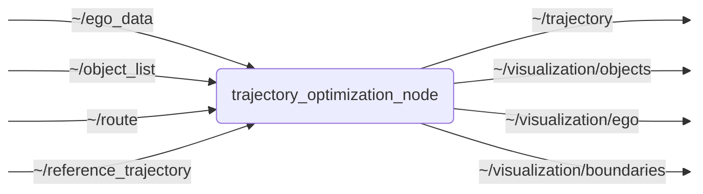

# `trajectory_optimization`

Periodically solves a nonlinear OCP to generate optimized trajectories for automated driving.

## Nodes

### `trajectory_optimization_node`

#### Subscribed Topics

| Topic | Type | Description |
| --- | --- | --- |
| `~/ego_data` | `perception_msgs/msg/EgoData` | Current ego vehicle state used to initialize and time-stamp the optimization problem. |
| `~/object_list` | `perception_msgs/msg/ObjectList` | List of objects considered by the OCP for collision avoidance. Depending on the configuration, objects can be considered as static (no prediction) or dynamic (with prediction). |
| `~/route` | `route_planning_msgs/msg/Route` | Route and lane boundary information used to constrain the OCP. |
| `~/reference_trajectory` | `trajectory_planning_msgs/msg/Trajectory` | Reference trajectory the OCP should follow. Depending on the configuration, the OCP can be set to run periodically on a timer or to run once for each received reference trajectory. |

#### Published Topics

| Topic | Type | Description |
| --- | --- | --- |
| `~/trajectory` | `trajectory_planning_msgs/msg/Trajectory` | Result of the OCP as drivable trajectory in the configured output frame. |
| `~/visualization/objects` | `visualization_msgs/msg/MarkerArray` | Debug markers visualizing the object boxes used by the OCP, the bounds of passed objects and the rear of followed objects. |
| `~/visualization/ego` | `visualization_msgs/msg/MarkerArray` | Debug markers visualizing the ego box used inside the OCP. |
| `~/visualization/boundaries` | `visualization_msgs/msg/MarkerArray` | Debug markers visualizing boundary points considered by the OCP. |

#### Parameters

| Parameter | Type | Default | Description |
| --- | --- | --- | --- |
| `vehicle_frame_id` | `string` | `"base_link"` | Frame ID of local vehicle frame (the ocp is defined in this frame) |
| `trajectory_frame_id` | `string` | `"base_link"` | Frame ID of output trajectory |
| `fixed_over_time_frame_id` | `string` | `"map"` | Frame ID of frame that is fixed over time for finding temporal transforms |
| `ego_data_timeout` | `float` | `1.0` | Time after which a received ego vehicle data is considered invalid [s]. Optimization will not be run if ego data is invalid. |
| `model_name` | `string` | `"karl"` | Name of the model to be used for trajectory optimization [karl, shuttle] |
| `optimization_frequency` | `float` | `10.0` | Optimization frequency in Hz |
| `n_shots` | `int` | `50` | Number of shooting intervals in optimization horizon |
| `optimization_horizon` | `float` | `1.0` | Optimization Horizon in seconds |
| `two_stage_optimization` | `bool` | `true` | Initialize the constrained OCP with a solve without object and boundary constraints |
| `relaxed_solve_timeout_ms` | `float` | `100.0` | ACADOS timeout for the relaxed initialization solve [ms]; 0 disables the timeout |
| `constrained_solve_timeout_ms` | `float` | `100.0` | ACADOS timeout for the fully constrained solve [ms]; 0 disables the timeout |
| `verbose` | `bool` | `false` | Print solver statistics |
| `performance_logging` | `bool` | `false` | Write one CSV record for every completed solver run |
| `debug_visualization` | `bool` | `false` | Publish debug visualization markers for ego, objects and boundaries |
| `run_as_callback` | `bool` | `false` | Run OCP once for each received reference trajectory (true) or on a timer (false) |
| `cost_weights` | `float[]` | `std::vector<double>(12, 1.0)` | Cost function weights |
| `dynamic_weight` | `float` | `1.0` | Dynamic weight alpha |
| `thw` | `float` | `2.0` | Desired time headway to followed objects [s]; soft when object slacks are enabled |
| `d_min_object_long` | `float` | `5.0` | Desired distance to followed objects [m]; soft when object slacks are enabled |
| `d_min_object_lat` | `float` | `0.5` | Desired lateral distance to passed objects of classes without an own value [m]; soft when object slacks are enabled |
| `d_min_object_lat_classes` | `int[]` | `[]` | Object classes (perception_msgs/ObjectClassification) with an own lateral distance |
| `d_min_object_lat_class_values` | `float[]` | `[]` | Desired lateral distance to passed objects per class in `d_min_object_lat_classes` [m] |
| `d_min_boundary_lat` | `float` | `0.0` | Minimum distance to keep to boundary in lateral direction [m] |
| `standstill_threshold` | `float` | `0.45` | Threshold for standstill detection [m/s]. If the velocities of all states are below this threshold, publish standstill trajectory |
| `high_level_stabilization` | `bool` | `false` | Use high-level stabilization strategy for init state (= init with current EgoData) |
| `consider_objects` | `int` | `2` | consider objects in optimization: 0 = none, 1 = static (no prediction), 2 = dynamic (with prediction) |
| `ignore_objects_behind_ego` | `bool` | `true` | Exclude objects with reference-point x <= 0 in vehicle_frame_id |
| `min_prediction_probability` | `float` | `0.0` | Minimum probability for predicted object states to be considered |
| `consider_boundaries` | `int` | `1` | consider route boundaries in optimization: 0 = no, 1 = suggested lane, 2 = including adjacent, 3 = drivable space |
| `bi_level_dV` | `float` | `2.0` | Threshold for bi-level stabilization: maximum velocity difference [m/s] |
| `bi_level_dY` | `float` | `0.3` | Threshold for bi-level stabilization: maximum y-offset [m] |
| `bi_level_dYaw` | `float` | `89.0` | Threshold for bi-level stabilization: maximum yaw difference [degree] |

#### Following and passing objects

Each object prediction is either followed or passed. Only positions the ego can still be next to at that stage count,
i.e. positions behind the ego even with full braking are ignored; a prediction without such positions is neither
followed nor passed.

- A prediction that crosses the reference path is followed.
- Otherwise it is passed if the ego fits next to it with the lateral distance of its class (`d_min_object_lat`,
  `d_min_object_lat_classes`) and the current ego pose already keeps this distance where the prediction is next to the
  ego. The room for passing is the suggested lane if the prediction is in that lane, otherwise the boundaries selected by
  `consider_boundaries`. A passed prediction stays passed while this holds with `d_min_object_collision`.
- A prediction enters the suggested lane when its center is in it at any stage, and leaves it only when none of its
  corners is in it any more.

Passed predictions bound the lateral offset of the ego from the reference path. Per stage, the followed prediction in the
suggested lane whose rear is closest along the reference path gives the follow distance (`d_min_object_long`, `thw`), if
the ego can still stay behind it with full braking. The desired distance is reduced by the part that full braking cannot
reach. If `d_min_object_long` is reachable only with full braking, the solve starts from the braking profile instead of
the warm start. With a follow distance, a rejected solve is retried once from the other initial guess within the
remaining `constrained_solve_timeout_ms`.

With `debug_visualization`, `~/visualization/objects` also shows the bounds of passed objects (green) and the rear of the
followed object per stage (red).

## Launch Files

### [`trajectory_optimization.launch.py`](launch/trajectory_optimization.launch.py)

| Argument | Default | Description |
| --- | --- | --- |
| `ego_data_topic` | `"~/ego_data"` | Topic on which to subscribe EgoData |
| `object_list_topic` | `"~/object_list"` | Topic on which to subscribe ObjectList |
| `reference_trajectory_topic` | `"~/reference_trajectory"` | Topic on which to subscribe reference trajectory |
| `route_topic` | `"~/route"` | Topic on which to subscribe route |
| `trajectory_topic` | `"~/trajectory"` | Topic on which to publish optimized trajectory |
| `boundary_marker_topic` | `"~/visualization/boundaries"` | Topic on which to publish boundary visualization markers |
| `ego_marker_topic` | `"~/visualization/ego"` | Topic on which to publish ego visualization markers |
| `object_marker_topic` | `"~/visualization/objects"` | Topic on which to publish object visualization markers |
| `name` | `executable_name` | node name |
| `namespace` | `""` | node namespace |
| `params` | `os.path.join(get_package_share_directory("trajectory_optimization"), "config", "params.yml")` | path to parameter file |
| `log_level` | `"info"` | ROS logging level (debug, info, warn, error, fatal) |
| `use_sim_time` | `"false"` | use simulation clock |
| `ros_tracing` | `"false"` | enable tracing |
| `driving_mode` | `"ackermann"` | driving mode, which determines the model and cost function configuration used for optimization [ackermann, rws] |

### [`trajectory_optimization_demo.launch.py`](launch/trajectory_optimization_demo.launch.py)
